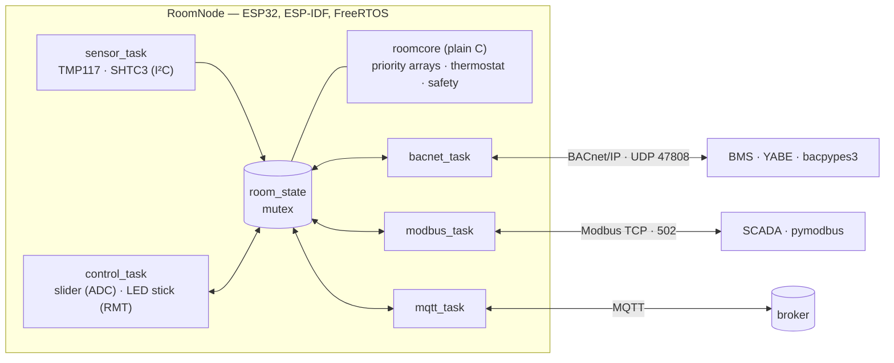

# RoomNode

[](https://github.com/mtoldi/room-node/actions/workflows/build.yml)
[](https://github.com/mtoldi/room-node/actions/workflows/tests.yml)
[](LICENSE)

A small but faithful building-automation room controller: an ESP32 node that measures room climate, runs a thermostat with BACnet command priorities and safety rules, and exposes its data over **BACnet/IP**, **Modbus TCP** and **MQTT**.

## Highlights

- **Embedded C on ESP-IDF and FreeRTOS**: one task per concern (sensors, control, BACnet, Modbus, MQTT), shared state behind a mutex, task watchdog.
- **BACnet/IP server** with Analog Input, Analog Value, Binary Output and Multi-state Value objects. The priority arrays on the setpoint and heating output are the controller's real ones, not copies.
- **Modbus TCP server written from scratch**: framing, FC03/04/06/16, exception responses, all-or-nothing multiple writes.
- **Safety rules expressed as BACnet priorities**: fail-safe, frost protection and minimum on/off time sit above the operator and the thermostat, so their precedence is explicit and testable.
- **Two-level Python test suite**: 67 module test cases run the C logic on a PC in under a second (CI on every push); 13 hardware-in-the-loop system tests check the real node with independent BACnet, Modbus and MQTT clients. See the [test plan](docs/test-plan.md).
- **Own drivers for the Soldered sensor boards** after two real issues with the stock libraries (see [design decisions](#design-decisions)).

## Architecture



Every decision is made in `roomcore`, which has no ESP-IDF or FreeRTOS dependency and takes time as a parameter. The tasks only move data between hardware, network and that core. All protocols read the same snapshot, so they always agree.

## Control logic

The heating output is a commandable point with a BACnet priority array: the highest filled level wins.

| Priority | Source | Rule |
| --- | --- | --- |
| 1 | Fail-safe | No valid temperature → off |
| 5 | Frost protection | Below 7 °C → on, released above 8 °C |
| 6 | Minimum on/off time | Every change is latched for 5 min (10 s in demo builds) |
| 8 | Operator | Mode on/off from BACnet, Modbus or MQTT |
| 16 | Thermostat | ±0.3 °C hysteresis around the setpoint |

Frost protection and the fail-safe therefore override the minimum on/off time, while the operator and the thermostat cannot. The setpoint is commandable too: its relinquish default follows the slider, a remote write at priority 8 overrides it, and moving the slider by more than 0.3 °C hands control back to the room. Remote clients may write at priority 8 only; the other levels belong to the controller.

## Interfaces

| Protocol | Port | Details |
| --- | --- | --- |
| BACnet/IP | UDP 47808 | Device 1001 with AI 1–3, AV 1, BO 1, MSV 1; Who-Is, ReadProperty, ReadPropertyMultiple, WriteProperty. [docs/points.md](docs/points.md) |
| Modbus TCP | TCP 502 | Input registers 0–8, holding registers 100–101. [docs/points.md](docs/points.md) |
| MQTT | 1883 | Retained state JSON, online/offline Last Will, setpoint and mode commands. [docs/mqtt.md](docs/mqtt.md) |

## Testing

| Level | Runs | Covers |
| --- | --- | --- |
| Module tests ([tests/module](tests/module)) | Any PC and CI, < 1 s | Controller and safety rules (including 24 simulated hours and the 49-day clock wrap), MQTT encodings, the Modbus protocol layer byte by byte |
| System tests ([tests/system](tests/system)) | Against the real node | BACnet discovery, reads and write rules; Modbus registers and exceptions; MQTT state, commands and reconnection; the same value across all three protocols |

The [test plan](docs/test-plan.md) lists the requirements, every test with its expected result, the manual tests and a traceability matrix. A system test run on the hardware is kept in [docs/reports](docs/reports/README.md); CI attaches the module test report to every build.

## Hardware

| Part | Role |
| --- | --- |
| Soldered Dasduino ConnectPlus (ESP32) | Room controller |
| Soldered TMP117 breakout | Reference temperature (±0.1 °C), I²C 0x49 |
| Soldered SHTC3 breakout | Auxiliary temperature and humidity, I²C 0x70 |
| Soldered slider potentiometer | Local setpoint, 16–26 °C |
| Soldered Smart LED WS2812B Stick10 | Heating output indicator (stands in for a relay or valve) |

Connections are in [docs/wiring.md](docs/wiring.md). No soldering beyond pin headers is needed.

## Quick start

Requires [ESP-IDF](https://docs.espressif.com/projects/esp-idf/) v6.0.3. ESP-IDF does not support spaces in paths, so keep ESP-IDF and this repository in a path without spaces.

```sh
git clone --recursive https://github.com/mtoldi/room-node.git
cd room-node/firmware/node
cp sdkconfig.defaults.local.example sdkconfig.defaults.local   # Wi-Fi, broker, node ID
idf.py set-target esp32
idf.py -p COM3 flash monitor
```

The **demo build** shortens the minimum on/off time to 10 s and regulates on a simulated room temperature, so the control loop can be watched within minutes:

```sh
idf.py -B build-demo -D SDKCONFIG=build-demo/sdkconfig \
       -D "SDKCONFIG_DEFAULTS=sdkconfig.defaults;sdkconfig.defaults.demo" -p COM3 flash monitor
```

**Tests:**

```sh
python -m venv .venv && .venv/bin/pip install -r tests/requirements.txt   # Windows: .venv\Scripts\
.venv/bin/pytest tests/module -v          # needs a C compiler (gcc/cc)
.venv/bin/pytest tests/system -v          # needs the node; edit tests/system/config.toml first
```

## Repository layout

```
firmware/node/
  main/                 tasks: sensors, control, BACnet, Modbus, MQTT, Wi-Fi
  components/roomcore/  controller, priority arrays, Modbus protocol layer, MQTT encodings (plain C)
  components/bacnet/    BACnet objects and UDP datalink; bacnet-stack as a submodule
  components/sensors/   TMP117 and SHTC3 drivers
  components/peripherals/  slider ADC and WS2812B stick
tests/module/           pytest + ctypes against roomcore
tests/system/           pytest against a running node
docs/                   points, MQTT, wiring, test plan, reports
```

## Design decisions

- **Logic separated from the RTOS.** Tasks only do I/O; every decision is made in `roomcore`, which takes time as a parameter. That makes it testable on a PC and keeps timing correct across the 49-day wrap of the millisecond counter.
- **Priority arrays instead of "last command wins".** The order of fail-safe, frost protection, minimum on/off time, operator and thermostat is written down once, in the same form BACnet uses, and every protocol goes through it.
- **Own Modbus implementation, bacnet-stack for BACnet.** Modbus TCP is small enough to implement and test byte by byte. BACnet is not, so encoding, services and BVLC come from [bacnet-stack](https://github.com/bacnet-stack/bacnet-stack); the Device object, the room objects and a socket-based datalink for ESP-IDF are implemented here. The stack is configured as a server: its defaults reserve about 400 KB of RAM for client transactions the node never starts.
- **Own sensor drivers.** The stock TMP117 library returns 0 °C on an I²C error, which passes any plausibility check, and rewrites the sensor's EEPROM on every boot. The TMP117 is now read register by register with every transfer checked and the device ID verified. The SHTC3 measures without clock stretching: in normal mode the sensor would hold SCL for up to 12 ms, at the edge of the ESP32 I²C timeout. The task sleeps during the conversion instead, so the bus stays free.
- **Safe start.** The output starts off and is held off for the minimum off time, so a node stuck in a reset loop cannot switch the heating rapidly. A task that stops feeding the watchdog resets the node.

## Roadmap

- HTTPS upload to a Cloudflare Worker and a live chart on a web page
- E-paper wall panel (Soldered Inkplate) reading the retained MQTT state
- DIN-rail enclosure with a separate sensor chamber
- Later: BACnet/SC, OPC UA, OTA updates

## License

MIT. The bacnet-stack submodule is GPL-2.0 with the GCC runtime library exception, which allows linking it into firmware under other licenses.
